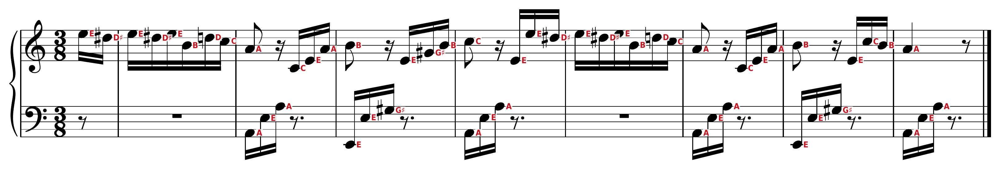

# Sheet Music Labeler

Writes the name of every note (C D E♭ … or Do Re Mi …) next to the note in a piano score, so you can read sheet music while you are still learning it.



*The opening of Beethoven's Für Elise, engraved with [Verovio](https://www.verovio.org) and labelled by the app.*

## Install (once)

First download the code (you need [git](https://git-scm.com/downloads)):

```bash
git clone https://github.com/claeslander/sheet-music-labeler.git
cd sheet-music-labeler
```

Then choose one of two ways:

- **A. The installer, for Linux:** one command installs everything and tests it. Recommended on Linux.
- **B. Manual installation, for Linux, macOS and Windows:** a few commands you run yourself.

### A. The installer (Linux only)

```bash
./install.sh
```

It takes a few minutes and needs about 1 GB of disk space in the project folder, plus up to 2 GB in your home folder for Audiveris. It runs as your normal user and does this:

1. installs [uv](https://docs.astral.sh/uv/) and Python 3.13 **inside the project folder** (`.tools/`), so it works whatever Python your distribution has;
2. installs the Python packages at the exact versions in `requirements.lock` into `.venv/`;
3. downloads the OMR model (about 130 MB);
4. installs [Audiveris](https://github.com/Audiveris/audiveris) from Flathub, for your user only (see [Orange = please check](#orange--please-check) for what it adds). If Flatpak itself is missing, it asks before installing it with your distribution's package manager (`apt`, `dnf`, `pacman` or `zypper`); that is the only step that uses `sudo`;
5. tests the result: the app reads a small test PDF and a small test score like a scan, and every note name is compared with the right one. The installer only says it worked when this test passes.

Options: `./install.sh --yes` doesn't ask anything, `./install.sh --no-audiveris` skips Audiveris. Running it again is safe: finished steps are skipped and broken ones are redone. If something fails, the reason is shown and the full log is in `.tools/install.log`.

Tested on Debian 12 and 13, Ubuntu 22.04 and 24.04, Fedora 44, Arch Linux and openSUSE Tumbleweed (x86_64). Audiveris was tested on Debian 13 only; on the others it was skipped, because Flatpak does not run inside the test containers. The installer needs a glibc-based distribution (not Alpine) and an x86_64 processor (aarch64 should work but is untested).

To uninstall, delete the project folder, and remove Audiveris with `flatpak uninstall --user org.audiveris.audiveris`.

### B. Manual installation (Linux, macOS, Windows)

**You need** Python 3.11 to 3.15 (check with `python3 --version`) and about 1 GB of disk space. The Windows and macOS commands should work but have not been tested.

**1. Install the Python packages.** They go into a `.venv` folder inside the project, so nothing is installed system-wide.

Linux and macOS:

```bash
python3 -m venv .venv
.venv/bin/pip install -r requirements.lock
```

Windows (PowerShell):

```powershell
py -m venv .venv
.venv\Scripts\pip install -r requirements.lock
```

This downloads about 600 MB and takes a few minutes. `requirements.lock` holds the exact versions that were tested together; `requirements.txt` lists only the direct dependencies, if you'd rather get the newest versions. On Debian or Ubuntu, if the first command says `ensurepip is not available`, run `sudo apt install python3-venv` and try again.

**2. Optional: install Audiveris**, for better results on scans (about 300 MB; scans take about twice as long). On Linux:

```bash
flatpak remote-add --if-not-exists --user flathub https://dl.flathub.org/repo/flathub.flatpakrepo
flatpak install --user flathub org.audiveris.audiveris
```

On Windows or macOS, install it from its [releases page](https://github.com/Audiveris/audiveris/releases). The app looks for an `audiveris` command; if it can't find one, set the `AUDIVERIS` environment variable to the full path of the Audiveris program.

**3. Check that it works:**

```bash
.venv/bin/python tests/selftest.py          # Windows: .venv\Scripts\python tests\selftest.py
```

It reads a small test PDF, and a small test score like a scan (downloading the OMR model the first time), and prints `OK` when every note is named correctly, and whether Audiveris was used.

## Use the app

1. Start it from the project folder:

   ```bash
   .venv/bin/python app.py          # Windows: .venv\Scripts\python app.py
   ```

   Your browser opens http://localhost:8765 (open it yourself if it doesn't). Keep the terminal open while you use the app; Ctrl+C stops it.

2. Add a score: drag a PDF, scan or photo (PDF, PNG, JPG, TIFF, BMP, GIF or WebP) onto the box on the left, or click the box and pick a file.

3. Wait for the result. It appears on the right:
   - a PDF exported from notation software takes a few seconds;
   - a scan or photo is detected automatically and read by the OMR model, which takes about 10-25 seconds per page (about 25 seconds with Audiveris, which runs at the same time).

4. Adjust it if you like. The score is redrawn straight away (scans are not read again):
   - **Names**: letters (C D E) or solfège (Do Re Mi)
   - **Colour**: red, blue, green or black
   - **Label size**: the size of the names

5. Click **Download labelled PDF**. The file gets `_note_names` added to its name.

For a scan, the status on the left (and the top of page 1 in the PDF) says how many notes are marked orange: check those, the app is not sure about them (see below). A PDF from notation software only gets orange marks in music without barlines (see [Limits](#limits)).

## Use the command line

```bash
.venv/bin/python note_names.py score.pdf                 # PDF from notation software
.venv/bin/python omr_label.py scan.pdf                  # scan or photo (PDF or image)
```

On Windows, use `.venv\Scripts\python` instead of `.venv/bin/python`. The result is saved next to the input as `score_note_names.pdf` (or `scan_note_names_omr.pdf`); pass a second file name to choose another. Options for both: `--style solfege`, `--color red|blue|green|black`, `--size 6` (label size in points).

## How it reads a score

Note names follow the notation exactly as written: the letter comes from the line or space the note sits on, the ♯/♭/♮ from the key signature and from accidentals earlier in the same bar. A note is never respelled (a B♭ stays B♭, it does not become A♯).

| | `note_names.py`: exact | `omr_label.py`: scans and photos |
|---|---|---|
| Works on | PDFs exported from notation software: MuseScore, Sibelius, Finale, Dorico, LilyPond, NoteWorthy, capella, Guitar Pro and others, also through "Print to PDF" | any image of a score |
| How | recognises the symbols of the music font embedded in the PDF by their shapes, and reads their exact positions | the local [homr](https://github.com/liebharc/homr) OMR model, checked by independent readings (see below) |
| Speed | well under a second per page | about 10-25 s per page on a CPU, about 25 s with Audiveris (restyling is instant) |
| Test piece (Rachmaninoff, Élégie op. 3 no. 1, 1,869 notes) | every note | 97.4% of notes named right, 7% marked orange, no unmarked name wrong (as a photo: 97.7%, 8% marked) |

The app tries the exact reader first and falls back to OMR automatically.

### How the exact reader knows the symbols

Every notation program draws music symbols as characters of a music font, and embeds that font in the PDF. Names and character codes differ per program (and "Print to PDF" hides the names), but the shapes don't: a sharp looks like a sharp in every font. So the reader draws each character the PDF uses from the embedded font and compares it with the same symbols in nine known music fonts (Bravura, Leland, Petaluma, Gootville, MuseJazz, Finale Maestro, Finale Broadway, and the Emmentaler of MuseScore and of LilyPond). A symbol also has to have the right size for what it resembles, measured in staff spaces: that keeps rests, flags, digits and the like from passing for noteheads or accidentals. The comparison also tells where a symbol's reference point lies, so clefs are placed on their line: treble, bass, alto, tenor and other C clefs all work. A clef in a style unlike any known font is still recognised by its size and position at the start of a line.

Measured on 12 pieces (piano music, songs, string quartets with alto and tenor clefs; 14,383 notes) engraved by MuseScore in each of its 8 music fonts, against the MusicXML they came from: 5 to 9 notes named wrong per font, 99.95% right. With a font left out of the known ones, so it has to be recognised from the others alone, 99.3% (Petaluma) and 99.25% (MuseJazz, a handwritten style) are still right. Ties carry an accidental over the barline (and over a line break), and a note high above or below its staff is given to the staff its ledger lines lead to.

### Orange = please check

On scans, every note is read twice, and with Audiveris installed three times:

1. by homr's transformer model, which outputs pitches including accidentals;
2. by geometry, without the model: the notehead's position on the staff, the clef, the key signature read from the printed signs, and sharps/flats/naturals detected and classified in the image, with accidentals lasting until the barline;
3. by [Audiveris](https://github.com/Audiveris/audiveris), whose symbol classifier tells noteheads apart from fingerings, dynamics, hairpins, rests and ottava lines.

When the model and the geometry disagree, or only one of them saw a note, the name is drawn in orange, and page 1 says how many notes to check. Audiveris settles two cases: a notehead that only the geometry saw and Audiveris did not is dropped (it is usually a fingering or a hairpin), and a disagreement of one accidental step (♮ against ♯, say) is not marked when Audiveris reads exactly what the model read. Audiveris does not name notes on its own: on the test piece it names 88% right, against 95% for the model.

On the test piece 7% of the notes get marked (10% without Audiveris). Of the names that are not marked, none on a note is wrong; 16 sit slightly off their note. About 3% of the notes are not detected at all and get no name. A dense 19th-century engraving (Chopin, Sonata op. 58, finale, 14 pages) gets about 11% marked.

Before reading, uneven light (a photo, a shadow, a yellowed page) is evened out, and a page is read at the resolution of its image (an A4 page at 300 dpi at most). Measured on piano pieces turned into images in several ways and compared with the MusicXML they came from: clean scans, scans at 100 to 150 dpi, noisy JPEGs, pages scanned 1.5° to 4° askew, faded print and photos of a page lying on a desk, with perspective and uneven light, are mostly 96 to 99.9% named right, with 2 to 10% marked and at most a few unmarked names wrong per piece. Harder are music full of accidentals (Schoenberg: about 90% right, 15 to 35% marked) and real scans with many clef changes in a line (a Breitkopf violin and piano score from 1918: about a third marked).

## Limits

- A PDF that draws its notes as plain shapes rather than as characters of a font (some PDF printer drivers, SCORE, MusiXTeX) is read by OMR, like a scan. A PDF that mixes exported pages with scanned ones gets names on the exported pages only.
- In music without barlines (Satie's Gnossiennes, for example) an accidental is taken to last until the end of the line, but editions differ (LilyPond hides barlines and still resets accidentals at them), so the exact reader marks the notes where that matters orange too.
- OMR misses clef changes in the middle of a line. Those notes get marked orange.
- Double sharps and flats in scans are often read as single ones, and marked orange.
- Names use real ♭ and ♯ signs when a font with them is installed (DejaVu Sans on Linux, Arial Unicode on macOS, Segoe UI Symbol on Windows); otherwise they are written as b and #.

## Files

- `note_names.py`: the exact reader, plus the label layout and drawing shared by both routes
- `glyph_shapes.py`, `glyph_refs.npz`: recognises music symbols in any font by their shapes; `tools/make_glyph_refs.py` makes the reference symbols from the known fonts
- `omr_label.py`: the scan route (homr, notehead splitting, accidental detection, the check between the readers)
- `audiveris.py`: runs Audiveris and names the noteheads it finds
- `app.py`, `app.html`: the local web app
- `install.sh`: the Linux installer
- `requirements.txt`, `requirements.lock`: the direct dependencies, and the exact tested versions of everything
- `tests/selftest.py`, `tests/test_score.pdf` (from `tests/test_score.musicxml`), `tests/fur_elise.png`: the end-to-end check the installer runs

## License

MIT, see [LICENSE](LICENSE). The libraries it builds on, [PyMuPDF](https://github.com/pymupdf/PyMuPDF) and [homr](https://github.com/liebharc/homr), are licensed under the AGPL-3.0, which applies to them when you redistribute or host the app together with them; [fontTools](https://github.com/fonttools/fonttools) is MIT. Audiveris (also AGPL-3.0) is not included: it is a separate program that the app runs if you have installed it. `glyph_refs.npz` holds small black-and-white drawings of music symbols from the fonts named above, which are all freely licensed (mostly under the SIL Open Font License).
